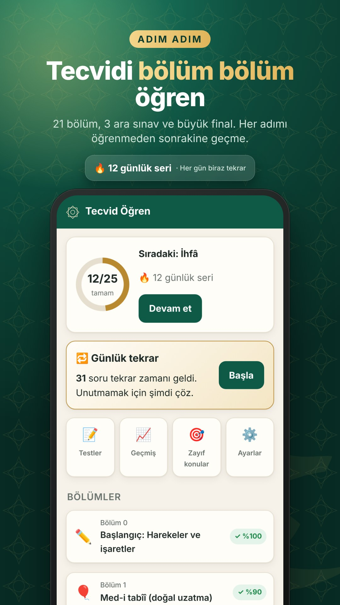
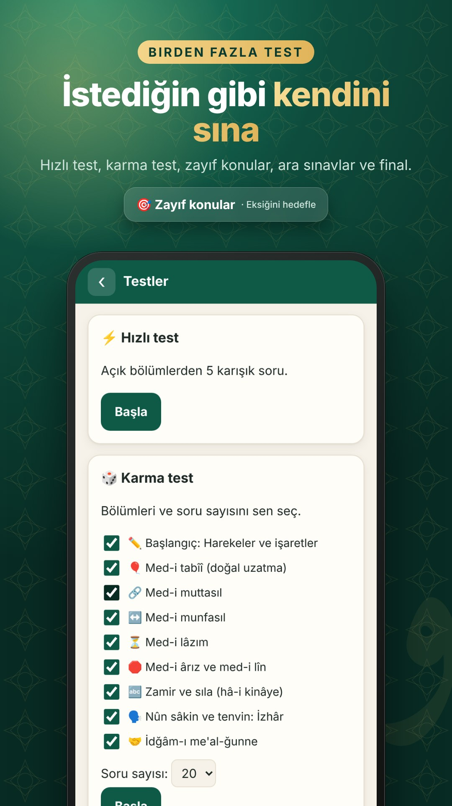

  

  <a href="https://github.com/Latif07/tecvid-ogren/releases/latest"><b>📥 Son sürümü indir (APK)</b></a>

---

## Ekran görüntüleri

  
  
  

  
  
  

  

---

## Nasıl öğretir?

Her bölüm aynı dört adımdan oluşur:

1. **📖 Ders** — Kural basit bir dille anlatılır, sonra ince ayrıntılarına inilir.
2. **🔍 Örnekler** — Kuralın geçtiği gerçek ayetler. İşaretli kelime vurgulanır, okunuşu yazılıdır. Ayeti ve kelimeyi dinleyebilirsin.
3. **✍️ Alıştırma** — Puansız, sınırsız soru. Her sorudan sonra açıklama gelir.
4. **✅ Test** — 10 soru. **%80** almadan sonraki bölüm açılmaz. Testlerde önceki bölümlerden de tekrar soruları çıkar.

### Unutmamak için: aralıklı tekrar
Yanlış yaptığın sorular kısa süre sonra tekrar karşına çıkar. Doğru bildiklerin ise 1, 2, 4, 8, 16… gün aralıklarla yeniden sorulur. Ana sayfadaki **Günlük tekrar** her gün sana zamanı gelen soruları getirir.

### Test seçenekleri
- **Bölüm testi** — her bölümün sonunda, geçme şartı %80
- **Ara sınavlar** — medlerden sonra, nûn/mîm kurallarından sonra ve en sonda
- **Büyük final** — bütün tecvidden 30 soru
- **Hızlı test** — 5 karışık soru
- **Karma test** — bölümleri ve soru sayısını (10/20/30/50) sen seçersin
- **Zayıf konular testi** — en çok yanlış yaptığın sorular
- **Günlük tekrar** — zamanı gelen sorular

### Renkli tecvid, kâri seçimi ve İngilizce
- **Renkli tecvidli yazı:** Örnek ayetlerde med, ğunne, ihfâ, idğâm, iklâb, kalkale ve okunmayan harfler kendi rengiyle gösterilir (Ayarlar'dan açılıp kapanır; testlerde renkler cevaptan sonra görünür).
- **Açık / koyu tema** ya da telefona göre otomatik.
- **Kâri seçimi:** Husarî ve Minşâvî (öğretim ve mürettel), Abdülbâsıt, Afâsî, Sudeys, Mâhir el-Muaykılî, Gâmidî.
- **English:** Bütün dersler, sorular ve menüler İngilizce de var (Ayarlar → Dil / Language).

### Geçmiş ve ilerleme
Her testin **tarihi, puanı, süresi** ve **bir önceki denemeye göre farkı** kaydedilir. Ayrıca puan grafiği, son 5 testin önceki 5 teste göre eğilimi ve konu konu başarı oranın görünür.

---

## Müfredat (21 bölüm + 4 sınav)

| # | Bölüm |
|---|---|
| 0 | Başlangıç: harekeler, cezm, şedde, tenvin, med harfleri, Medine mushafı işaretleri |
| 1 | Med-i tabîî |
| 2 | Med-i muttasıl |
| 3 | Med-i munfasıl |
| 4 | Med-i lâzım (kelime/harf, müsakkal/muhaffef) |
| 5 | Med-i ârız ve med-i lîn |
| 6 | Zamir ve sıla (hâ-i kinâye) |
| 🏁 | **Ara sınav 1: Bütün medler** |
| 7 | Nûn sâkin ve tenvin: İzhâr |
| 8 | İdğâm-ı me'al-ğunne |
| 9 | İdğâm-ı bilâ-ğunne |
| 10 | İklâb |
| 11 | İhfâ |
| 12 | Mîm sâkin (ihfâ-i şefevî, idğâm-ı misleyn, izhâr-ı şefevî) |
| 13 | Ğunne |
| 🏁 | **Ara sınav 2: Nûn, mîm ve ğunne** |
| 14 | İdğâmlar: misleyn, mütecâniseyn, mütekâribeyn |
| 15 | Kalkale |
| 16 | Lâm-ı tarif: şemsî ve kamerî |
| 17 | Lafzatullah |
| 18 | Râ harfi: kalın ve ince |
| 19 | Vakf, durak işaretleri ve sekte |
| 20 | Hafs'a özel okunuşlar: imâle, işmâm, teshîl |
| 🏁 | **Ara sınav 3** |
| 🏆 | **Büyük final** |

Toplam **497 soru**, **111 ayetten 167 örnek**. Rivayet: **Hafs an Âsım**.

---

## Kurulum

1. [Releases](https://github.com/Latif07/tecvid-ogren/releases/latest) sayfasından `tecvid-ogren.apk` dosyasını telefona indir.
2. Dosyayı aç. Telefon "bilinmeyen uygulamalar" izni isterse ver.
3. Yeni sürümler eskisinin üstüne kurulur, ilerlemen silinmez.

> Sesler internet ister. Dersler, testler ve geçmiş internetsiz çalışır. Bütün veriler yalnızca telefonunda saklanır. Ayarlar'dan yedek alıp geri yükleyebilirsin.

## Nasıl derlenir?
Kod `main` dalına her gönderildiğinde GitHub Actions (`.github/workflows/apk.yml`) APK'yı otomatik derler ve **Releases** bölümüne koyar. Uygulama HTML/JavaScript ile yazıldı ve [Capacitor](https://capacitorjs.com) ile Android'e paketlendi.

## Kaynaklar
- **Kur'an metni:** King Fahd Complex — Medine mushafı (Hafs), quranenc.com üzerinden ([quran-json](https://github.com/risan/quran-json)), CC BY-SA 4.0
- **Ayet sesleri:** [everyayah.com](https://everyayah.com) arşivi (Husarî, Minşâvî, Abdülbâsıt, Afâsî, Sudeys, Muaykılî, Gâmidî)
- **Renkli tecvid:** [cpfair/quran-tajweed](https://github.com/cpfair/quran-tajweed) karar ağaçlarıyla üretilen etiketler (CC BY 4.0)
- **Kelime sesleri:** [Quran.com](https://quran.com)
- **Tecvid kuralları:** sorularlaislamiyet.com tecvid özeti; Diyanet Mushafları İnceleme Kurulu tebliğleri; SeekersGuidance (vakf işaretleri)
- **Yazı tipi:** Scheherazade New — SIL International, OFL 1.1

> Tecvid kulaktan öğrenilen bir ilimdir. Bu uygulama bir hocadan ders almanın yerini tutmaz, onu destekler.
