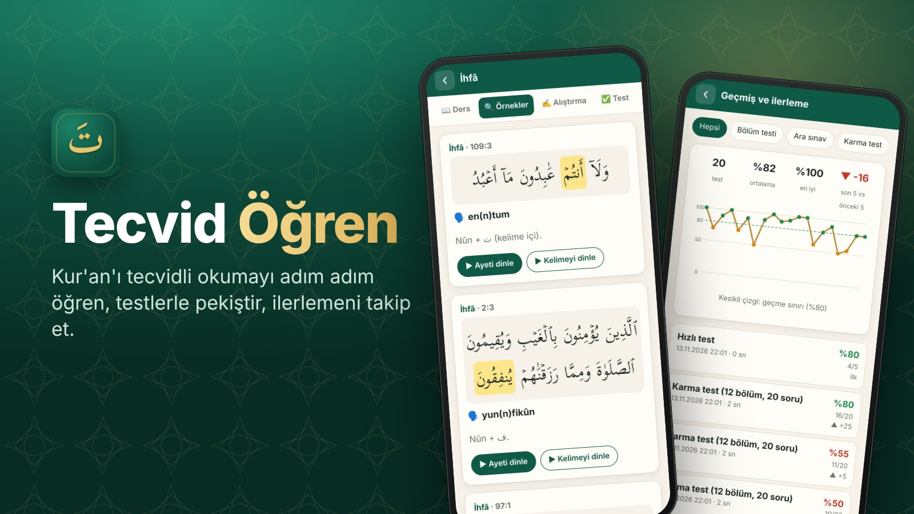
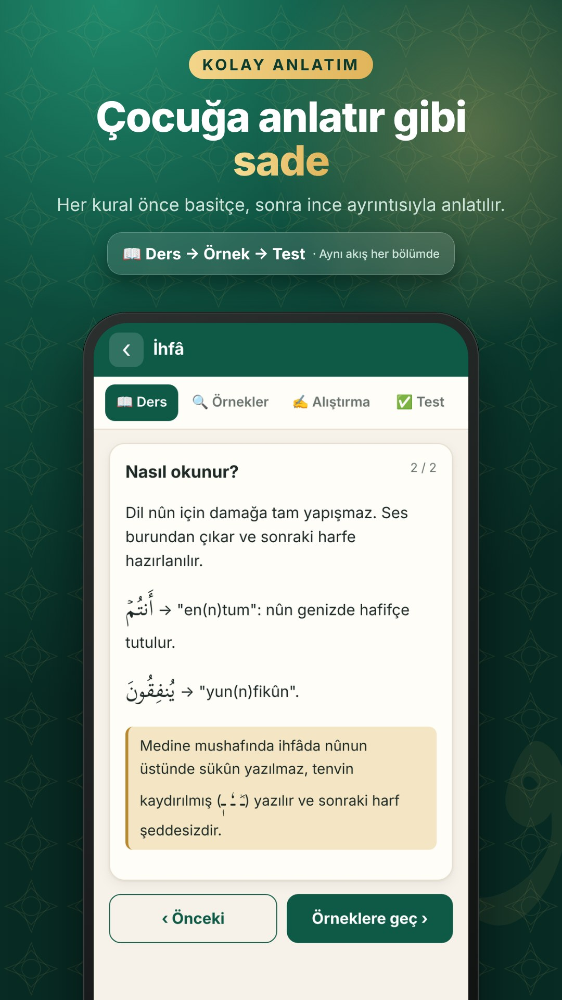
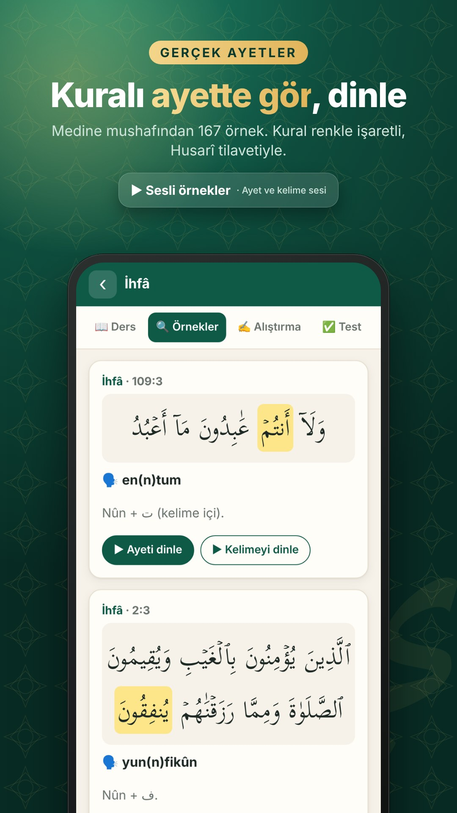
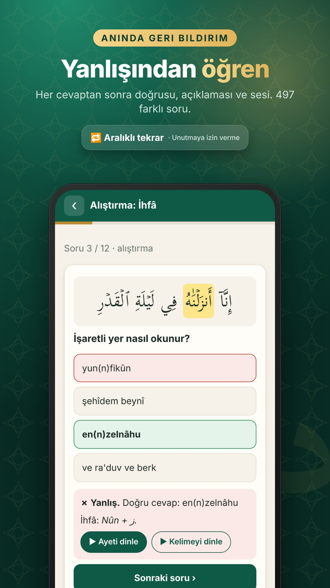
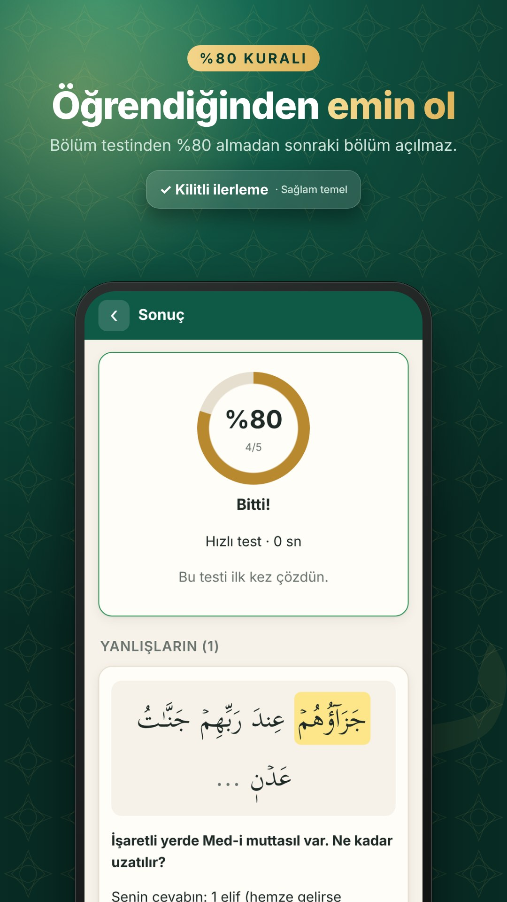
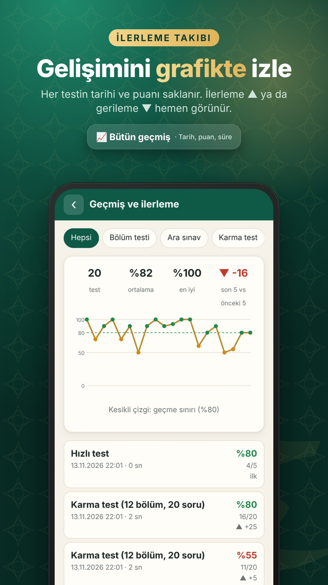

  

<h1 align="center">Hüsn-i Kıraat</h1>

<i>«Sizin en hayırlınız Kur'an'ı öğrenen ve öğretendir.» (Buhârî, Fezâilü'l-Kur'ân 21)</i>

  <a href="https://github.com/Latif07/tecvid-ogren/releases/latest"><b>📥 Son sürümü indir (APK)</b></a>

---

## Ekran görüntüleri

  
  
  

  
  
  

  

---

## Nasıl öğretir?

Her bölüm aynı dört adımdan oluşur:

1. **📖 Ders** — Kural basit bir dille anlatılır, sonra ince ayrıntılarına inilir.
2. **🔍 Örnekler** — Kuralın geçtiği gerçek ayetler. İşaretli kelime vurgulanır, okunuşu yazılıdır. Ayeti ve kelimeyi dinleyebilirsin.
3. **✍️ Alıştırma** — Puansız, sınırsız soru. Her sorudan sonra açıklama gelir.
4. **✅ Test** — 10 soru. **%80** almadan sonraki bölüm açılmaz. Testlerde önceki bölümlerden de tekrar soruları çıkar.

### Unutmamak için: aralıklı tekrar
Yanlış yaptığın sorular kısa süre sonra tekrar karşına çıkar. Doğru bildiklerin ise 1, 2, 4, 8, 16… gün aralıklarla yeniden sorulur. Ana sayfadaki **Günlük tekrar** her gün sana zamanı gelen soruları getirir.

### Test seçenekleri
- **Bölüm testi** — her bölümün sonunda, geçme şartı %80
- **Ara sınavlar** — medlerden sonra, nûn/mîm kurallarından sonra ve en sonda
- **Büyük final** — bütün tecvidden 30 soru
- **Hızlı test** — 5 karışık soru
- **Karma test** — bölümleri ve soru sayısını (10/20/30/50) sen seçersin
- **Zayıf konular testi** — en çok yanlış yaptığın sorular
- **Günlük tekrar** — zamanı gelen sorular

### Renkli tecvid, kâri seçimi ve İngilizce
- **Renkli tecvidli yazı:** Örnek ayetlerde med, ğunne, ihfâ, idğâm, iklâb, kalkale ve okunmayan harfler kendi rengiyle gösterilir (Ayarlar'dan açılıp kapanır; testlerde renkler cevaptan sonra görünür).
- **Açık / koyu tema** ya da telefona göre otomatik.
- **Kâri seçimi:** Husarî ve Minşâvî (öğretim ve mürettel), Abdülbâsıt, Afâsî, Sudeys, Mâhir el-Muaykılî, Gâmidî.
- **English:** Bütün dersler, sorular ve menüler İngilizce de var (Ayarlar → Dil / Language).

### Okuma raporu (yapay zekâ)
Ayetin altındaki 🎤 ile oku: telefonda çalışan bir model okuyuşunu dinler ve kelime kelime **harf, hareke, med süresi, ğunne, ihfâ, iklâb, idğâm, şedde ve kalkale** hatalarını gösterir (🔴 açık hata, 🟠 ince hata). Profil → Okuma raporu'nda en sık hataların ve haftalık gelişimin görünür. Ses hiçbir yere gönderilmez.
Model: [HisnLabs tajweed-v2](https://huggingface.co/Hisnlabs/tajweed-v2) (Apache-2.0). Yapay zekâ yanılabilir; bir hocanın yerini tutmaz.

### Sınıflar
Öğrenci birden çok sınıfa katılabilir. Sınıfta herkes **sıralamayı** görür (geçilen bölüm, ortalama puan, ezber, hatasız okuma oranı, seri); hoca ödev verir, ezber kaydı dinler.

### Görünüm
Açık / koyu tema ve renk seçenekleri: yeşil, lacivert, bordo, mor, sepya.

### Ezber (hıfz)
- **Ezber modu:** Kelimeleri yarısı / ilk kelime hariç / tamamı olarak gizle; gizli kelimeye dokununca açılır. "Dinle, tekrar et, gizle" ile ayeti önce dinle, sonra ezberden oku. "✓ Ezberledim" ile ilerlemeni işaretle.
- **Bugünkü plan:** Hafızlık usulüyle yeni ders + yakın tekrar + uzak tekrar (aralıklı tekrar).
- **Ezber yoklaması:** Sonraki ayet, önceki ayet, ayetin devamı, hangi sûre ve benzer ayet soruları.
- **Sayfa sayfa okuma:** Medine mushafı 604 sayfa, cüz bilgisi; **sayfa başı / sonu yoklaması**; **hatim takvimi** (günlük sayfa hedefi).
- **Benzer (müteşâbih) ayetler:** Farklı kelimeler işaretli karşılaştırma.
- **Meal:** Diyanet (Türkçe) / Saheeh International (İngilizce), aç-kapa.
- **Hocaya ezber dinletme:** Sınıftaki öğrenci ezberini kaydedip gönderir; hoca dinler, "Güzel / Tekrar çalış" ve not verir.

### Bütün Kur'an, internetsiz ses ve diğerleri
- **114 sûre renkli tecvidle:** Sûre ara, dinle (1/3/5 tekrar), kelimeye dokunup kelimeyi dinle, kendini kaydedip kâriyle karşılaştır, her sûrede "kural bul" testi.
- **Kural ara:** Bir sûrede sadece seçtiğin kuralı renklendir ya da bir kuralın bütün Kur'an'da nerelerde geçtiğini gör.
- **İnternetsiz ses:** Seçtiğin kârinin ders ve sûre seslerini telefona indir (Ayarlar → İnternetsiz ses, ya da sûre sayfasından).
- **Okunuş:** Fâtiha ve son 10 sûrede Latin harfle okunuş açılıp kapanır (Türkçe ve İngilizce; yaklaşık yazımdır, asıl olan dinlemek).
- **Yazı boyutu:** Genel yazı ve Arapça yazı ayrı ayrı büyütülebilir.
- **Hoca–öğrenci sınıfı:** Hoca sınıf kodu verir, öğrencilerinin ilerlemesini görür, ödev verir.
- **Günlük hatırlatma:** Seçtiğin saatte bildirim; o gün çalıştıysan gelmez.

### Geçmiş ve ilerleme
Her testin **tarihi, puanı, süresi** ve **bir önceki denemeye göre farkı** kaydedilir. Ayrıca puan grafiği, son 5 testin önceki 5 teste göre eğilimi ve konu konu başarı oranın görünür.

---

## Müfredat (27 bölüm + 4 sınav)

| # | Bölüm |
|---|---|
| 0 | Elif-Ba: Arap harfleri |
| 1 | Başlangıç: harekeler, cezm, şedde, tenvin, med harfleri, Medine mushafı işaretleri |
| 2 | Mahrecler: harflerin çıkış yerleri |
| 3 | Harflerin sıfatları |
| 4 | Karıştırılan harfler (dinleyerek) |
| 5 | Med-i tabîî |
| 6 | Med-i muttasıl |
| 7 | Med-i munfasıl |
| 8 | Med-i lâzım |
| 9 | Med-i ârız ve med-i lîn |
| 10 | Zamir ve sıla (hâ-i kinâye) |
| 🏁 | **Ara sınav 1: Bütün medler** |
| 11 | Nûn sâkin ve tenvin: İzhâr |
| 12 | İdğâm-ı me'al-ğunne |
| 13 | İdğâm-ı bilâ-ğunne |
| 14 | İklâb |
| 15 | İhfâ |
| 16 | Mîm sâkin |
| 17 | Ğunne |
| 🏁 | **Ara sınav 2: Nûn, mîm ve ğunne** |
| 18 | İdğâmlar: misleyn, mütecâniseyn, mütekâribeyn |
| 19 | Kalkale |
| 20 | Lâm-ı tarif: şemsî ve kamerî |
| 21 | Lafzatullah |
| 22 | Râ harfi: kalın ve ince |
| 23 | Vakf, durak işaretleri ve sekte |
| 24 | Hafs'a özel okunuşlar: imâle, işmâm, teshîl |
| 25 | Lahn: okuma hataları |
| 26 | Okuma adabı, istiâze ve besmele |
| 🏁 | **Ara sınav 3** |
| 🏆 | **Büyük final** |

Toplam **596 soru**, **111 ayetten 167 örnek**, ayrıca 114 sûrenin tamamı renkli tecvidle. Rivayet: **Hafs an Âsım**.

---

## Kurulum

### iPhone / iPad (ücretsiz web sürümü)
1. iPhone'da **Safari** ile [latif07.github.io/tecvid-ogren](https://latif07.github.io/tecvid-ogren/) adresini aç.
2. **Paylaş** → **Ana Ekrana Ekle** → **Ekle**.
3. Ana ekrandaki **Tecvid** simgesinden aç. Dersler, testler, Kur'an metni ve geçmiş internetsiz de çalışır.

> Web sürümünde sesler internet ister; ses indirme ve günlük hatırlatma bildirimi şimdilik yalnızca Android uygulamasında var.

### Android

1. [Releases](https://github.com/Latif07/tecvid-ogren/releases/latest) sayfasından `tecvid-ogren.apk` dosyasını telefona indir.
2. Dosyayı aç. Telefon "bilinmeyen uygulamalar" izni isterse ver.
3. Yeni sürümler eskisinin üstüne kurulur, ilerlemen silinmez.

> Sesler internet ister (indirdiğin sesler hariç). Dersler, testler, Kur'an metni ve geçmiş internetsiz çalışır. Bütün veriler yalnızca telefonunda saklanır. Ayarlar'dan yedek alıp geri yükleyebilirsin.

## Nasıl derlenir?
Kod `main` dalına her gönderildiğinde GitHub Actions (`.github/workflows/apk.yml`) APK'yı otomatik derler ve **Releases** bölümüne koyar. Uygulama HTML/JavaScript ile yazıldı ve [Capacitor](https://capacitorjs.com) ile Android'e paketlendi.

## Kaynaklar
- **Kur'an metni:** King Fahd Complex — Medine mushafı (Hafs), quranenc.com üzerinden ([quran-json](https://github.com/risan/quran-json)), CC BY-SA 4.0
- **Ayet sesleri:** [everyayah.com](https://everyayah.com) arşivi (Husarî, Minşâvî, Abdülbâsıt, Afâsî, Sudeys, Muaykılî, Gâmidî)
- **Renkli tecvid:** [cpfair/quran-tajweed](https://github.com/cpfair/quran-tajweed) karar ağaçlarıyla üretilen etiketler (CC BY 4.0)
- **Kelime sesleri:** [Quran.com](https://quran.com)
- **Tecvid kuralları:** sorularlaislamiyet.com tecvid özeti; Diyanet Mushafları İnceleme Kurulu tebliğleri; SeekersGuidance (vakf işaretleri)
- **Yazı tipi:** Scheherazade New — SIL International, OFL 1.1

> Tecvid kulaktan öğrenilen bir ilimdir. Bu uygulama bir hocadan ders almanın yerini tutmaz, onu destekler.
